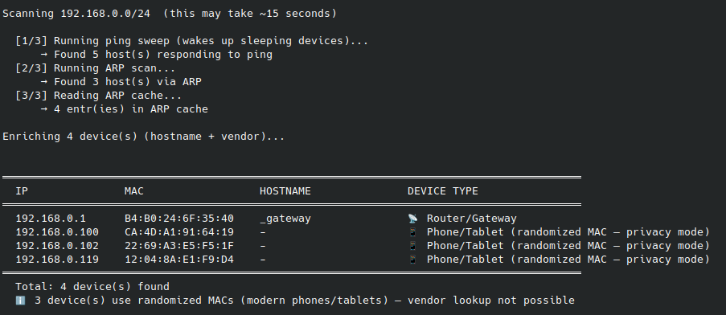
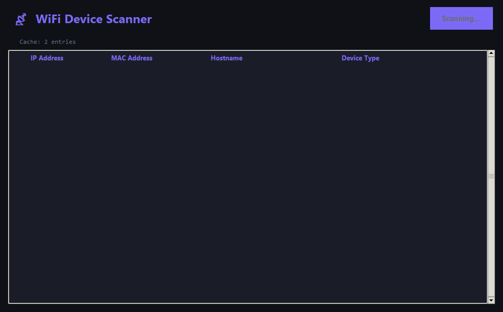
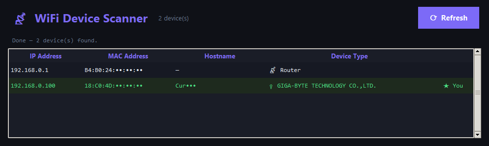

[](https://x.com/NorowaretaGemu)
[](https://opensource.org/licenses/MIT)
  
  <br>
<div align="center">
  <a href="https://ko-fi.com/cursedentertainment">
    
  </a>
</div>
  <br>

<div align="center">
  
</div>
<div align="center">
    
  
  
  
  </div>
  <br>

# Scan-WIFI-Devices

Find every device on your Wi-Fi: IP, MAC, hostname, maker and a best guess at what it is
(phone, router, PC, Linux box, smart TV). Combines a ping sweep, an ARP scan and the kernel's ARP
cache, so sleeping phones show up too. Terminal, Tkinter and Pygame versions.

**Website:** https://cursedprograms.github.io/Scan-WIFI-Devices/

[Farica☆Kimora](https://github.com/Farica-Kimora) © Cursed Entertainment



### The Tkinter window

| Scanning | Done |
| --- | --- |
|  |  |

A real scan of a small home network: the router and this PC (MAC addresses and hostname masked).

## What you need
- **Linux** (it uses `ping -c`, `ip neigh` and raw ARP packets; on Windows it says so and stops).
- **Python 3.9+** and root for the ARP scan.

## How to run
```bash
python -m venv venv && source venv/bin/activate
pip install -r requirements.txt          # requests, scapy, pygame
sudo -E ./venv/bin/python scan_wifi.py           # terminal table
sudo -E ./venv/bin/python scan_wifi_tkinter.py   # window with a sortable list and Refresh
sudo -E ./venv/bin/python scan_wifi_pygame.py    # animated Pygame window
```
A scan takes about 15 seconds on a /24 network.

## How it works
1. **Ping sweep** of the whole subnet, 100 at a time - wakes devices up and fills the ARP cache.
2. **ARP scan** with scapy (when it's installed and you're root).
3. **ARP cache** from `ip neigh`.
4. Each device gets its hostname (reverse DNS), its maker from the MAC (api.macvendors.com) and a
   type guess. Phones and tablets that **randomize their MAC** (the "locally administered" bit)
   are flagged as such, since no maker can be looked up for them.

Only scan networks you own or are allowed to scan.

## Tests
`python -m pytest` checks the MAC and device-type helpers (run by the GitHub workflow on every push).

<div align="center">
<a href="https://cursedprograms.github.io/Scan-WIFI-Devices/" target="_blank">
    
</a>
</div>

## License
MIT, see [LICENSE](LICENSE).

---

<br>
<div align="center">
© Cursed Entertainment 2026
</div>
<br>
<div align="center">
<a href="https://cursed-entertainment.itch.io/" target="_blank">
    
</a>
</div>
